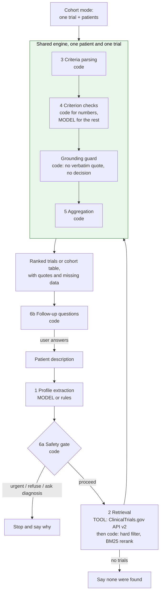

# Architecture

## Data flow

Both modes run the same engine (green). They differ only in direction and aggregation.

## Components

| # | Module, entry point | Purpose | Input | Output | Call type |
|---|---|---|---|---|---|
| 1 | `profile.py`, `extract_profile` | Structure the free text | Patient text | `PatientProfile` | Model (rules offline) |
| 2 | `retrieval.py`, `retrieve` | Find candidates and drop impossible ones | Profile | Query and ranked `Trial`s | External API, then code |
| 3 | `parsing.py`, `parse_criteria` | Split eligibility text into checkable statements, and keep its structure (options, subgroups, participant groups) | Eligibility text | `Criterion` list | Code |
| 3b | `parsing.py`, `extract_entities_*` | Entity extraction measured against Chia | Criterion lines | `Entity` list | Model, or Chia gazetteer offline |
| 4 | `checker.py`, `check_criteria` | Decide each criterion, with a quote | Criteria, patient text, profile | `CriterionCheck` list | Code for numbers, model for the rest |
| 5 | `aggregate.py`, `aggregate` and `rank` | Statuses to verdict | Criteria, checks | `TrialVerdict` | Code |
| 6a | `safety.py`, `assess` | Decide whether to run at all | Text, profile | `SafetyDecision` | Code |
| 6b | `followup.py`, `generate_questions` | Find the most useful missing facts | Verdicts, patient text | Questions | Code |

`pipeline.py` wires these. `llm.py` is the only path to a model, and adds caching, JSON validation, and tracing.

**Interface.** `server.py` (FastAPI) streams progress and results from `pipeline.py`, and a React app in `web/` displays them. The interface makes no decisions, so the evals cover what it shows.

**Cohort mode's trial picker** shows suggested trials, live search, and the trial's criteria as `parse_criteria` splits them, before anything is checked. It makes no model calls.

**Cohort search** (`trialmatch/patient_search.py`) finds patients for a chosen trial in the 1,620 PMC case reports. It's BM25 with the trial's conditions (weight 3), title, keywords, and inclusion criteria as the query, aliases such as "t2dm" mapped to one concept, and plural stemming. Patients ruled out by age or sex (from PMC's own fields) go last. It makes no model calls, returns a shortlist of 10 with the sentence that matched, and the user picks which to screen. Scored by the reverse TREC eval (`evals/eval_patient_search.py`).

**When the model fails.** The interface falls back to the rule-based baseline, step by step: rules replace the profile if extraction fails, and replace the checker for any trial whose check fails. Affected trials are labelled "Rules only". This is switched on only by `server.py`. The pipeline's default, used by every eval, is to raise the error.

## Why these components

- **Status is judged on the statement, polarity in code.** A model decides whether "active hepatitis B" is true of the patient. `effect()` decides what that means for inclusion or exclusion. Mixing the two is an easy way to get a confident, inverted answer.
- **The grounding guard sits outside the model.** The prompt asks for a quote, and code checks that it is really in the patient text. A prompt alone can't enforce that.
- **Numbers stay in code.** Comparing 8.4 with 7.0 needs no judgement, so a model has no way to add value and some way to add error.
- **Three outcomes, not two.** Most errors that matter here are guesses about things the record doesn't say. `insufficient` makes abstaining a real output, and it drives the follow-up questions.
- **Aggregation is plain code.** The verdict has to be auditable, so it can't depend on a model's mood.
- **Rule baseline.** It gives each LLM score something to beat, and it lets the app run without a key.
- **Screening-only criteria.** Consent and investigator judgement can't be read from any record, so they aren't counted as missing data.
- **Trial structure is kept by parsing and applied in code.** Trials list alternatives ("eligible diseases listed below"), criteria for one subgroup ("For SPMS, ..."), sections for other people (a donor or relative), and separate participant groups. Parsing marks these on each criterion, and aggregation uses the marks. The model never sees them, so its prompt and cached answers stay the same.

## Verdicts

| Verdict | Rule |
|---|---|
| `not_eligible` | Any inclusion is `not_met`, or any exclusion is `met` |
| `insufficient_data` | No blockers, and over 60% of checkable criteria are unknown |
| `needs_more_data` | No blockers, some unknown |
| `likely_eligible` | No blockers, none unknown. Study staff still confirm screening-only criteria |

Structure changes what counts as a blocker:

- **Option group:** counts as one criterion. It blocks only when too few options are left open to reach the number needed (usually one).
- **Conditional criterion:** may not apply to this patient, so a result that would block becomes unknown, for a person to check.
- **Donor or relative section:** skipped.
- **Several participant groups:** each group is judged with the shared criteria, and the patient gets the best fit. The verdict names the group.

## One input through the system

Run it live with `python -m scripts.trace_input --vignette d01`.

1. **Input:** "58-year-old woman with type 2 diabetes… HbA1c 8.4%… She denies any history of heart failure."
2. **Profile:** age 58, female, diagnoses `type 2 diabetes`, labs `hba1c=8.4`, absent `heart failure`.
3. **Safety:** a diagnosis exists and nothing is urgent, so `proceed`.
4. **Retrieval:** `query.cond="type 2 diabetes"`, recruiting only. Trials outside her age and sex drop out, the rest are reranked, and the top 5 continue.
5. **Parsing:** one trial's text becomes inclusion and exclusion statements. "Signed informed consent" is marked screening-only.
6. **Checks:** `HbA1c ≥ 7.0% and ≤ 9.0%` is compared in code: `met`, quote "Most recent HbA1c 8.4%". `History of heart failure` is `not_met`, quote "denies any history of heart failure". `Myocardial infarction within 6 months` is `insufficient`, because the text is silent.
7. **Aggregation:** no blockers, some unknown, so `needs_more_data`, or `insufficient_data` when too much is unknown.
8. **Follow-up:** "Does the patient have, or has the patient had, myocardial infarction? If yes, when?" The answer joins the patient text and steps 1 to 7 run again, so a later quote can cite it.

## Safety properties, and where each is enforced

| Property | Enforced by | Tested in |
|---|---|---|
| No decision without a verbatim quote | `checker._check_llm_batch` | `test_llm_decision_without_real_quote_becomes_insufficient` |
| Silence is not evidence | Prompt, rule logic | `test_silence_is_insufficient`, invented-decision metric |
| Final decision isn't made by a model | `aggregate.py` | Truth-table eval |
| Every criterion is checked | `check_llm` batching | `test_every_criterion_reaches_the_model_across_batches` |
| Off-topic and urgent input stops | `safety.py` | `eval_safety`, `test_urgent_beats_everything` |
| Rule results are never shown as model results | `pipeline.evaluate`, "Rules only" label | `test_full_outage_falls_back_to_rules_and_says_so` |
| An outage can't change eval scores | Fallback is off by default | `test_evals_never_fall_back` |
| Patient and trial text are data | Delimiters and prompt | **Not measured.** See limitations in the report |
